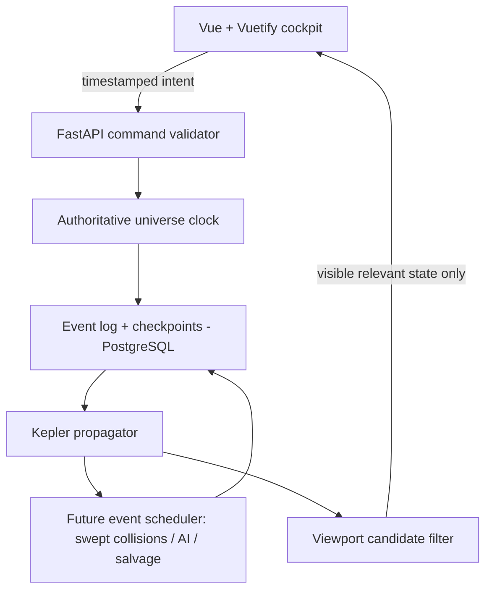

# Persistent universe: design decision record

## Invariants

1. The backend is the eventual authority for entity state and the universe clock.
2. Unpowered two-body motion uses an exact-to-tolerance conic propagator `S(t)=Phi(S(t0),t-t0)`.
3. Changes to motion, inventories or identity are written as timestamped events. After each committed event, a checkpoint establishes new orbital initial conditions.
4. A state query for a region must resolve every causally relevant earlier interaction, not merely propagate whichever entities happen to be visible.
5. Objects may persist outside every active viewport and have no artificial expiration.
6. Frontend extrapolation is cosmetic; it must reconcile to the backend and must never authorize fuel or inventory transfers.

## This iteration's boundary

The backend supports independent two-body entities with post-impulse checkpoints, event history, and snapshot queries. **It deliberately does not claim to resolve collisions**, so the current authoritative model is only correct between independent manoeuvre events. The legacy browser game still simulates collisions locally.

## Data flow target

**Why the viewport needs a causal halo:** a distant projectile may enter the screen and collide with something before the read timestamp. Bounding a query to currently visible entities is insufficient; phase 2 will use time-bounded orbital occupancy and scheduled events. Ordinary snapshots can be cached, but collisions must be evaluated in a consistent total event order.

## Time and historical queries

The authoritative world clock is a stored epoch; a query `at_s` is seconds since epoch. Server commands choose their own timestamps. Historical queries select the last post-event checkpoint before the requested timestamp; future queries are labelled predictions. Each state carries a version number for client reconciliation.

## Schema and scale plan

`worlds` stores the gravity parameter and epoch; `entities` stores last checkpoint, current orbital envelope and version; `events` stores post-event states and idempotent command IDs. SQLite enables immediate local testing, PostgreSQL is supported by the SQLAlchemy URL and should be used for production. Avoid per-frame database writes.

For interacting bodies: durable event queue; coarse radial/spatial orbit indexes; exact predicted encounter times; transactional resolution with locks in deterministic `(at_s,event_priority,entity_id)` order. Cross-sector dependencies cannot be resolved by eagerly updating only the queried entity.
