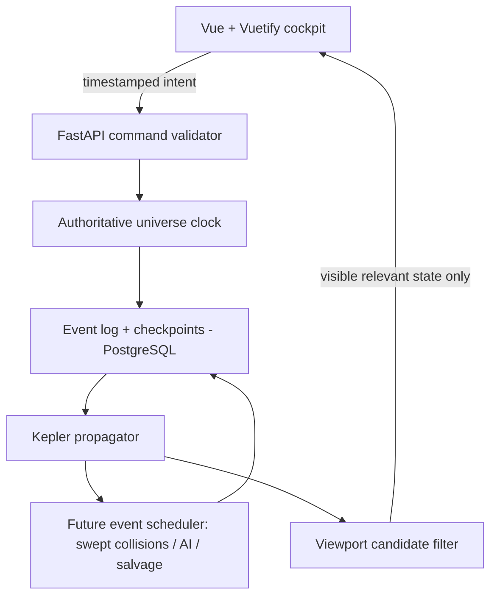

# Persistent universe: design decision record

## Invariants

1. The backend is the eventual authority for entity state and the universe clock.
2. Unpowered two-body motion uses an exact-to-tolerance conic propagator `S(t)=Phi(S(t0),t-t0)`.
3. Changes to motion, inventories or identity are written as timestamped events. After each committed event, a checkpoint establishes new orbital initial conditions.
4. A state query for a region must resolve every causally relevant earlier interaction, not merely propagate whichever entities happen to be visible.
5. Objects may persist outside every active viewport and have no artificial expiration.
6. Frontend extrapolation is cosmetic; it must reconcile to the backend and must never authorize fuel or inventory transfers.

## This iteration's boundary

The backend supports independent two-body entities with post-impulse checkpoints, event history, and snapshot queries. **It deliberately does not claim to resolve collisions**, so the current authoritative model is only correct between independent manoeuvre events. The legacy browser game still simulates collisions locally.

## Data flow target

**Why the viewport needs a causal halo:** a distant projectile may enter the screen and collide with something before the read timestamp. Bounding a query to currently visible entities is insufficient; phase 2 will use time-bounded orbital occupancy and scheduled events. Ordinary snapshots can be cached, but collisions must be evaluated in a consistent total event order.

## Time and historical queries

The authoritative world clock is a stored epoch; a query `at_s` is seconds since epoch. Server commands choose their own timestamps. Historical queries select the last post-event checkpoint before the requested timestamp; future queries are labelled predictions. Each state carries a version number for client reconciliation.

## Schema and scale plan

`worlds` stores the gravity parameter and epoch; `entities` stores last checkpoint, current orbital envelope and version; `events` stores post-event states and idempotent command IDs. PostgreSQL is required; its URL is loaded from `backend/.env`. Avoid per-frame database writes.

For interacting bodies: durable event queue; coarse radial/spatial orbit indexes; exact predicted encounter times; transactional resolution with locks in deterministic `(at_s,event_priority,entity_id)` order. Cross-sector dependencies cannot be resolved by eagerly updating only the queried entity.

## Persistent manual pilot (experimental)

The browser uses an anonymous local pilot ID to resume a PostgreSQL entity. A `flight_controls` row stores a 0.4-second lease for main thrust, RCS turn/stabilization and gimbal. The server integrates only the leased control interval and then lazily propagates an unpowered Kepler orbit. Each control update produces an event plus a checkpoint; viewport and history reads reconstruct leased movement without trusting client coordinates. The ship is authoritative for motion and fuel only; collision, combat, inventory and NPC events still need server-side causal resolution. `ORBITAL_DEV_COMMANDS=1` must never be exposed publicly.

## v0.9 live connection and progression

A FastAPI WebSocket streams player orbital snapshots (~10 Hz) and receives pilot control edges, finite-thrust lease renewals, technology purchases and idempotent local-development salvage claims. Rendering/prediction stays on the browser frame loop. PostgreSQL `player_progress` persists credit balance and purchased upgrades; `salvage_claims` deduplicates pickup rewards. Pending salvage claims are retained in the browser until the server acknowledges them. The game intentionally retains GET `/` as its health endpoint and HTTP for read/debug only. **The entire live socket is development-only** (`ORBITAL_DEV_COMMANDS=1`) because there is no authentication and salvage rewards are not server-verified. Production must validate pickups from authoritative world events before allowing currency changes.

## v0.10 navigation and pilot encounters

The existing rendezvous planner now converts guidance to the same RCS/thrust WebSocket inputs as the manual pilot. The backend remains authoritative for movement and fuel, but navigation itself is currently client-side and stops if the cockpit tab loses visibility or connection.

The development-only `encounter_snapshots` table stores each pilot's local NPCs, pickups, killed enemies and reinforcement settings. The WebSocket resumes that checkpoint on reconnect, using lazy Kepler coasting during the elapsed wall time. It does not execute NPC AI, projectiles, collisions or combat while offline, nor share NPC authority between different pilots. This is a transitional continuity mechanism, not the final multiplayer world state.

Fullscreen Navigation, Telemetry and Ship panels are floating canvas HUD windows whose positions remain a browser-side UI preference, outside the server's simulation state.

## v0.11 autonomous pilot sectors

\`backend/app/universe.py\` runs authoritative pilot-sector NPC decisions, limited impulsive maneuvers, projectile creation, Newtonian motion, swept projectile/body and ship/ship collision tests, hull/ammo changes, physical salvage and event logs. The state is persisted in PostgreSQL \`encounter_snapshots\`. The server advances it over elapsed wall time when \`player_encounter\` is called; no browser-provided snapshot, kill count, or credit claim is trusted. Active clients receive sector snapshots over the existing WebSocket and render smooth local extrapolation.

This initial version is pilot-scoped. Player flight and propellant remain in \`entities\`/\`flight_controls\`, and sector collisions may append a \`sector_interaction\` checkpoint/event to the player entity. NPC offline catch-up uses adaptive finite slices rather than a globally scheduled exact spacetime event queue. It does not yet guarantee synchronized inter-player causality, and is not a production-scale server simulation.

\`backend/app/reset_dev.py\` provides explicitly confirmed pilot/world database resets. The frontend Options API shell (matching the Axore Vue convention) supports independent docking, minimizing and dragging for every HUD panel; layout is local browser state and not part of the universe.

## v0.13 incoming faction visitors, reward accounting, Vue panel migration

The development-only `POST /dev/players/{pilot_id}/raiders` and
`POST /dev/players/{pilot_id}/allies` each create one ship inside the
pilot's persisted `encounter_snapshots`. Arrivals start beyond 950 km from
Kestrel with negative radial velocity and positive two-body orbital energy.
Each independently receives a 50/50 `flyby`/`orbit` arrival intention.
A flyby retains its hyperbolic trajectory. Orbit-intent ships burn actual
propellant using an instantaneous delta-v near periapsis to match circular
velocity; their status becomes `orbiting` only after a successful capture.
The baseline AEGIS escort remains the `ally` field; additional friendlies
are stored as `allies` and participate in targeting, combat, collisions and
the streamed snapshot, rendered by the browser.

Salvage effects and Comms messages are computed from actual acquired
resources, including partial fuel/repair-part pickups near capacity.
Unrewarded full-capacity pickups are not consumed.

The first fully reactive Options API panels are Comms, Ship and Technology
Market. `frontend/src/services/cockpit.ts` defines the typed state bridge
and purchase events; the legacy standalone HTML retains DOM compatibility.
The next migration targets remaining telemetry/navigation and renderer
separation.

## v0.14 random launch and development respawn

Incoming NPCs launch outside Kestrel with independently random velocity
directions on [0, 2pi) and variable 20–32 km/s speeds; position angle and
velocity angle are independent. Their flyby/orbit intention produces an
actual fuel-consuming approach impulse after 2.5 seconds, and orbit-intent
NPCs execute a second circularization impulse near periapsis. The initial
angular momentum sign sets clockwise/counterclockwise arrival; both are
supported. These are deliberately instantaneous maneuvers and are not
the final physical finite-burn guidance system.

New player accounts and explicitly respawned destroyed pilots start in
the same outer region with random 360-degree launch velocity, but pilot
attitude and arrival guidance are manual; the server does not burn fuel
without control inputs. Dev-only POST /dev/players/{pilot_id}/respawn
updates the player entity checkpoint, resets flight control, restores
player-only hull/ammo/spares, and appends a respawn event, leaving the
pilot's technology/credits and independent NPC sector intact.

## v0.15 Vue instrument and autonomous support boundary

Telemetry, Targeting and Navigation are Vue Options API state/event consumers. The canvas drawing code has moved to `frontend/public/legacy/rendering.js`, while the legacy script still owns simulation state, animation scheduling and inputs. `WebSocket /players/{pilot_id}/live` and REST `/players`, `/worlds`, `/dev` intentionally omit `/api`; Vite proxies these root paths. Planetary motion and salvage collisions remain server-owned during persistent play. Salvage encounters now check swept proximity (19 km) but require relative velocity under 5 km/s; a high-speed flyby is reported, not captured. Friendly and hostile NPC factions can autonomously redistribute propellant with mass-conserving, low-velocity rendezvous support. Player-to-ally donations are server-authorized, guarded by close approach, and deduct real player fuel/mass. This is an incremental NPC heuristic, not optimal low-thrust guidance or shared-world causality.

Respawning destroyed pilots restores starter credits and loses upgrades, without erasing their NPC sector. The dead camera is never overlaid by an opaque modal so spectators can continue observing.

## v0.16 player reserve policy and cockpit streamlining

The pilot chooses a propellant reserve in kilograms (0–200, default 36). This lives in a dedicated `player_settings` table to avoid modifying existing `player_progress` schema, persists across respawn, and is delivered in WebSocket progress snapshots as `reserve_kg`. REST `POST /players/{pilot_id}/reserve` and WebSocket `reserve` commands validate it server-side. Client-side navigation uses that reserve when planning, authorizing and terminating automatic burns; setting changes invalidate existing plans. Server-side player-to-ally donations enforce the same reserve when subtracting fuel and spacecraft mass, so clients cannot bypass it. Manual pilot thrust is intentionally unrestricted by this autopilot/donation policy. NPCs maintain separate autonomous fuel safety rules. The legacy Friendly Escort UI panel has been removed, but allied craft, rescue requests and selected-ally donations remain available through the map and Navigation panel.

## v0.17 — orbital guidance versus mission intelligence

`backend/app/npc_guidance.py` evaluates possible departure waits and encounter durations with Kepler propagation and numerical shooting; it rejects unsafe periapses, insufficient propellant and impulsive plans that cannot be executed by a finite-duration engine. Rescue orders retain their plan phases in the authoritative sector snapshot. NPC thrust is integrated at each simulation timestep (fuel mass and acceleration evolve continuously), replacing the previous instantaneous donor velocity correction. Small raider tactical adjustments also use the finite-burn queue. The inbound visitor insertion/course logic still uses legacy impulses; this is explicitly not yet an all-NPC low-thrust navigation system. Higher-level coordination, global fuel-optimal search, targeting strategy and physical spacecraft capture remain future work.

The `capture` upgrade is persistent pilot progress. Backend pickup collision resolution reads pilot upgrades before advancing the sector: base speed threshold 5 km/s, upgraded threshold 8 km/s, with the same 19 km swept contact test. This is still a simplified salvage interaction, not a solved conservation model for a tractor beam.

## v0.18 — finite arrivals, cooperative tactics and physical capture

Incoming visitors keep their independent 360-degree launch velocities, but `arrival_guidance.py` now selects bounded finite-thrust approach/correction/insertion maneuvers by numerical previews of actual rocket burns. Existing flight and support bodies share `npc_guidance.move_with_burn`: there is no free arrival-course impulse. The control loop waits for completed burns before planning the next correction. This improves physical consistency but cannot guarantee every arbitrary launch has enough fuel or time to insert. `npc_intelligence.py` implements short-horizon collision/periapsis risk screening, finite evasions, threat-biased interceptor allocation and raider target priorities. Rescue phase updates can perform bounded pre-arrival trajectory corrections, with one donor assigned per rescue.

Salvage capture uses a reduced-mass inelastic coupling: `dv_ship = m_payload/(m_ship+m_payload) * (v_payload-v_ship)`, with `E_thermal = 0.5*m_ship*m_payload/(m_ship+m_payload)*|v_rel|²` (MJ when masses are kg and speeds km/s). The server applies the incoming material mass and velocity impulse to the pilot's authoritative checkpoint; it records heat in the sector snapshot and radiates 8 MJ/s. A full heat sink or heavy wreck rejects capture even when the 5/8 km/s contact limit passes. Fuel and nonfuel mass are accounted separately to avoid double-counting; the physical pickup remainder persists after partial collection. The client-only mode mirrors this model and the connected cockpit extrapolates NPC finite burns cosmetically. Remaining approximations include finite-force tether dynamics, impulse timing within offline catch-up windows, weapon mass exhaust, and independent energy dissipation during ship-to-ship impact.

## v0.19 — grappling with bounded tension

The previous instant inelastic salvage coupling is now only the **final
low-relative-speed lock**. The encounter's persistent `captureTether` state
stores the payload ID, initial mass, time, tension history, thermal dissipation,
powered reel work, fatigue and duration. `tether.step_tether` applies an axial
internal tension (never a push), capped to 2,200 N / 12,000 N for basic/upgraded
hardware. Force produces equal and opposite instantaneous differential velocity
increments `dv = F dt / mass` to KESTREL-7 and the debris, conserving total
linear momentum. The rocket's authoritative pilot checkpoint receives the sum
of finite tension-induced velocity changes; the still-approximate end-of-tick
checkpoint method does not reconstruct the exact intervening burn history. The
sector stores the grapple, heat, motor work, and failure events. The cockpit
and local fallback show the reel progressing in time, instead of granting
instant salvage. Rope length, braking distance, thermal capacity, accumulated
fatigue and a final low-speed capture condition determine success and failure.
